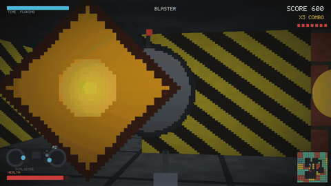
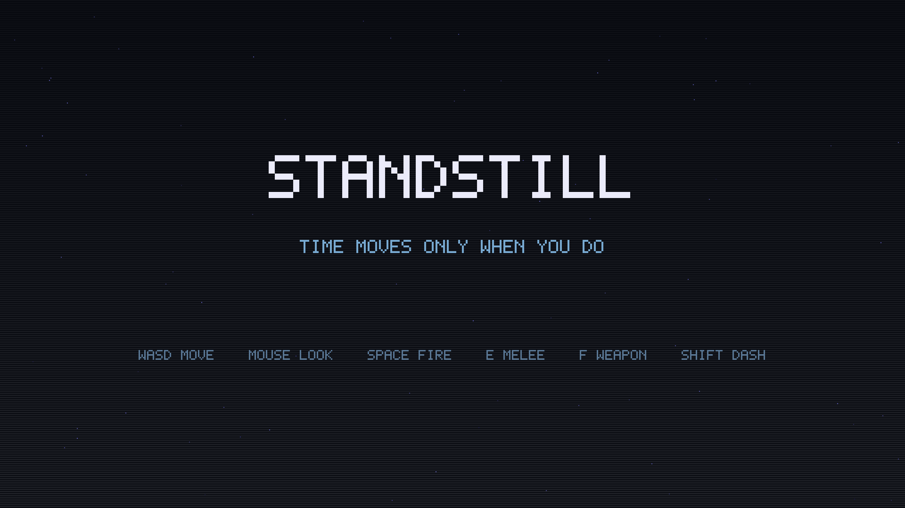
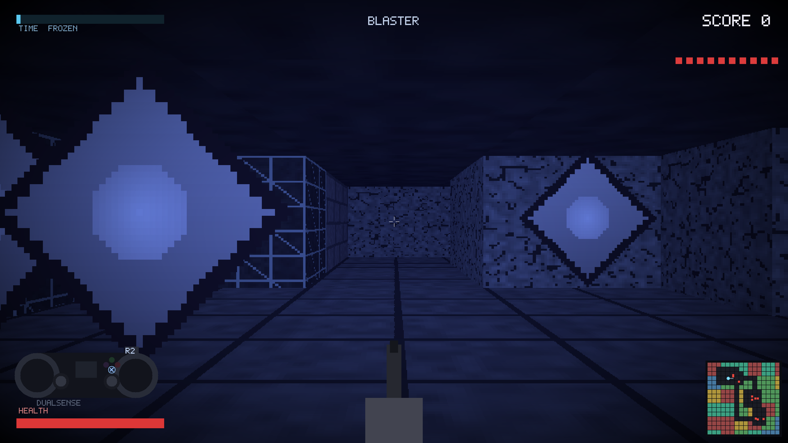
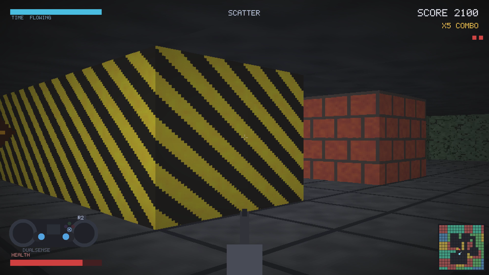
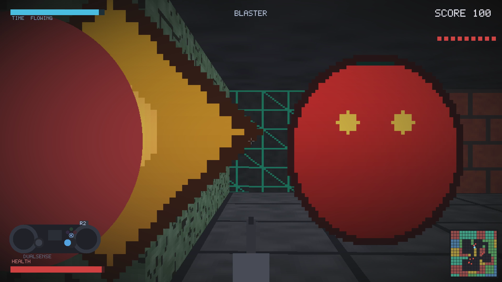

# STANDSTILL

A boomer-shooter where **time only moves when you do.** A SUPERHOT-style twist on
a classic software raycaster: stand still and the world freezes — enemy bullets
hang in the air — then move or turn and everything surges forward.

Built from scratch in portable **C11 + SDL2**. There are no external assets —
every texture, sprite, sound, and the music are generated from math — so it stays
small and cross-compiles cleanly to PS5 homebrew.



▶ **[Watch the full gameplay video](media/standstill-gameplay.mp4)** (with sound)

|  |  |
|:--:|:--:|
|  |  |
|  |  |

## Features
- Framebuffer **textured raycaster** — procedural brick / metal / stone / hazard /
  circuit walls, textured floor & ceiling, distance fog, vignette
- **Time-freeze** color-grade (desaturate + blue tint) that slows the world — the hook
- **Procedurally generated** rooms + corridors every run, with a real-time minimap
- **3 enemy types** with procedural sprites — drone (fast), brute (tanky),
  spitter (3-bullet spread)
- Multi-weapon combat: blaster / scatter, melee, dash — with a live
  DualSense-style on-screen input indicator
- Score + combo, screen-shake, particles, muzzle flash
- Fully **procedural 8-bit music + SFX** that slow and quiet when you freeze time
- Keyboard + mouse **and** gamepad (DualSense / Xbox)

## Build & run
Requires SDL2. On NixOS:
```sh
nix-shell
make run
```
Any other distro: install the SDL2 dev package, then `make run`.

## Controls
| Action | Keyboard / Mouse | Gamepad |
|---|---|---|
| Move / strafe | WASD | Left stick |
| Look | Mouse / ← → | Right stick |
| Fire | Space / Left-click | R2 / ✕ |
| Melee | E | □ |
| Switch weapon | F | △ |
| Dash | Shift | ◯ |
| Pause | Esc | Options |
| Quit | Q (pause/title) | — |

Stand still to freeze time; move to let it flow. Clear every enemy to win.

## PS5 homebrew
The renderer is deliberately software/2.5D and the whole thing is self-contained,
so it targets the open **PS5 homebrew SDK** (ps5-payload-dev) → an ELF that runs
via `elfldr` on a jailbroken console, and can be relink-tested on desktop through
[AnyPS5](https://github.com/boykopovar/AnyPS5).

## License
MIT — see [LICENSE](LICENSE).
